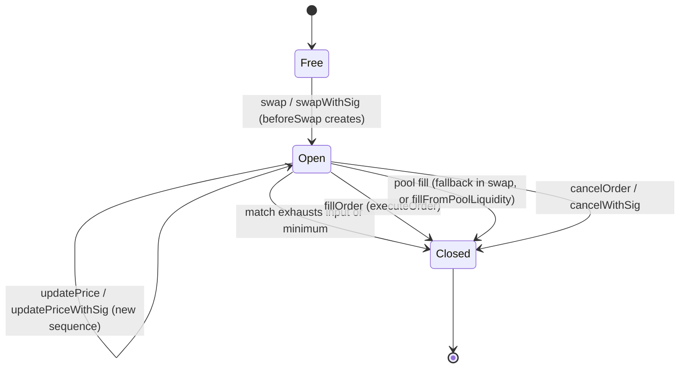
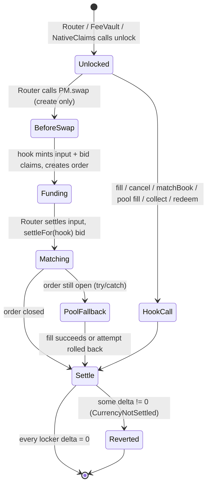

# Async Swap v2: protocol state machine

This is the state machine of the **official** Async Swap v2 protocol, as implemented in
`official/src` (this folder). "Official" means:

- the external interface and behaviour of the `asyncswap/v2` draft: entry-point names, arguments,
  events, EIP-712 domains `"AsyncSwap","1"` and `"AsyncSwap Router","1"`, and the `HookSwap` event;
- plus the two improvements accepted in decision 9 (see §5):
  - **Bid escrowed at create.** `_beforeSwap` takes the USDC bid as a hook claim, and the Router settles it for the
    hook in the same unlock. There is no `recordPriorityFee`, no `priorityFeeEscrowed` field and no
    `PriorityFeeNotEscrowed` error.
  - **Maker salt.** On `Router.swap` the maker chooses the salt. A salt of `0` keeps v2's block-data derivation,
    and `swapWithSig` always derives it.

Every state variable and transition is mapped to the Lean model (`AsyncSwapProtocol/V2/Model.lean`,
`AsyncSwapSpec/*.lean`) and to the Solidity names in `official/src`. Provenance tags:

| Tag | Meaning |
| --- | --- |
| **proved** | A Lean theorem covers it (named; every name was grepped in this repo). |
| **v1-model** | Proved, but only in the v1 production model `AsyncSwapProtocol/Model.lean`, `Settlement.lean` (namespace `AsyncSwapProtocol`, not `.V2`). |
| **v2-behaviour** | Official behaviour that the Lean model does not contain yet (decisions 7, 10, and some of v2's interface). Tested at best. |
| **improvement** | Decision 9. The Lean model still has the older shape; the equivalence is noted. |

The names in this file (states `S.*`, transitions `T.*`, invariants `I.*`) are the reference names
for the diagrams and docs.

---

## 0. Conventions

- `c` ranges over a pool's two currencies `currency0 < currency1`. `N` is the **numeraire** (USDC, an
  ERC-20, never native). It may be `currency0` or `currency1` (v2-behaviour, decision 10). The Lean
  model fixes `N = currency1` (`numeraire : Currency := true`). Only `currency0` can be native ETH.
- For an order `o`: `in(o) = zeroForOne ? currency0 : currency1`, `out(o)` is the other currency,
  `buy(o) = (in(o) = N)`. Lean: `OrderKey.input`, `OrderKey.output`, `OrderKey.isBuy` (`= !zeroForOne`
  because `N = currency1`).
- Amounts are unbounded naturals and ledgers are signed integers (README, decision 2). Overflow is a
  separate set of bound theorems (§3, `I.Bounds`).
- A transaction either commits or reverts as a whole: Lean `Option World`, `none` = revert.
- `fee(m) = poolFee m = floor(3·m/997)`, `gross(m) = m + fee(m)`, so `fee = 30 bps of gross`
  (`AsyncSwapSpec/Fee.lean`: `poolFee_eq`, `gross_split`, `poolFee_eq_30bps_of_gross`).
- `pay(c, r, n)`: pay `n` of `c` out of the PoolManager to `r`: ERC-6909 claims if `c` is native,
  tokens otherwise. Lean `Tx.payOut … (cfg.isNative c)`.

---

## 1. State

### 1.1 Global and per-deployment

| Variable | Type | Lean | Solidity (v2) |
| --- | --- | --- | --- |
| PoolManager, hook, router, vault, NativeClaims addresses | `address` (pairwise distinct) | `Config.pm`, `.hook`, `.router`, `.vault`, `.nativeClaims` + `*_ne_*` fields | immutables |
| Numeraire `N` | ERC-20 currency | `numeraire` (fixed `currency1`) | `AsyncSwap.numeraire` (constructor; reverts `InvalidNumeraire` if no code) |
| Native currency0? | `bool` | `Config.native0`, `Config.isNative` | `currency0 == address(0)` |
| Signature oracle | digest × signer → bool | `Config.sigOk` | `SignatureChecker.isValidSignatureNow` (EOA / ERC-1271) |
| Hook owner / pending owner | `address` | `World.owner`, `World.pendingOwner`; `AsyncSwapSpec.Admin.owner/.pendingOwner` | `owner`, `pendingOwner` (two-step ownership written inline in `AsyncSwap`) |
| Hook signed-action nonces | `maker → uint256 → bool` | `World.hookNonce`; `Admin.nonceUsed` | `AsyncSwap.nonceUsed` |
| Router cancel nonces | `maker → uint256 → bool` | `World.routerCancelNonce` | `Router.cancelNonceUsed` |
| Permit2 nonces | `owner → uint256 → bool` | `World.permit2Nonce` | Permit2 unordered nonce bitmap (external) |

### 1.2 Ledgers (per currency `c`)

| Ledger | Type | Lean | Meaning |
| --- | --- | --- | --- |
| Wallet balances | `c → address → ℤ` | `World.bal` | ERC-20 / ETH held by an address, including `bal c pm` (the PoolManager's reserves of the token) and `bal c hook` (the hook's own balance, which only `sweep` and the native-fill deposit touch). |
| ERC-6909 claims | `c → address → ℤ` | `World.claims` | PoolManager claims. The hook's claims are the escrow; the vault's are fees and forfeited bids; makers and fillers hold native proceeds as claims. |
| Claim supply (ghost) | `c → ℤ` | `World.claimsSupply` | `Σ_a claims c a`, maintained by `mint` / `burn` only. |
| Pool reserves | `c → ℤ` | `World.reserves` | Tokens inside the PoolManager owned by the pool: LP liquidity, LP fees, donations. |
| Has active liquidity | `bool` | `World.hasLiquidity` | `getLiquidity(poolId) != 0`. Changed only by LPs (outside the protocol). |
| Locker deltas (transient) | `c → address → ℤ` | `Tx.delta` | v4 currency deltas of router / hook / vault / NativeClaims inside one `unlock`; all must be `0` when `unlock` returns. |
| Pending native deposit (transient) | `uint256` | `Tx.pendingNative` | ETH a filler forwarded to the hook for the fill in progress (`PENDING_NATIVE_DEPOSIT_SLOT`). Reset to `0` at the end of the fill. |

### 1.3 Per pool

| Variable | Type | Lean | Solidity |
| --- | --- | --- | --- |
| Ordering mode | `FIFO \| PriorityFee` | `World.priorityMode : Bool` | `Book.orderingMode` |
| Next sequence | `uint64` | not in `V2.World`; `AsyncSwapSpec/Priority.lean` (`reprice_sequence_last`), `sequenceAfter` (`Bounds.lean`) | `Book.nextSequence` |
| Open orders | set of ids | `World.openKeys : Finset OrderKey` | implicit: `orders[id].amountIn != 0` |
| Bid / ask price trees | `RadixPriceTree` of `uint128` keys | `AsyncSwap.PriceIndex` / `Trie` (functional, `RadixTree.lean`), `AsyncSwap.Tree` (storage, `RadixStorage.lean`) | `Book.bids`, `Book.asks` |
| Price level | FIFO queue + (priority mode) priority-key tree | `AsyncSwap.PriorityLevel`, `fifoAppend` (`Priority.lean`) | `bidLevels[key]`, `askLevels[key]` |
| Executor grants | `maker → executor → bool` | `World.isExecutor` | `State.isExecutor` |

### 1.4 Per order (key `id = keccak(chainId, poolId, owner, zeroForOne, salt)`)

| Field | Type | Lean (`OrderKey` / `OrderInfo`) | Notes |
| --- | --- | --- | --- |
| owner, zeroForOne, salt | address, bool, bytes32 | `OrderKey.owner/.zeroForOne/.salt` | The id preimage; keccak is injective (`orderId_inj` in `Hashing.lean`). The salt is not stored: it is the final value from `S.salt` (§2.4 `T.swap`), emitted in `AsyncOrderCreated`, and callers pass it back in `order.salt`. |
| amountIn | `uint256` | `OrderInfo.amountIn` | remaining escrowed input; `0` ⇔ slot free |
| amountOutMin | `uint256` | `OrderInfo.amountOutMin` | remaining minimum output |
| priorityFee | `uint64` | `OrderInfo.priorityFee` | remaining escrowed USDC bid |
| escrowed | none in `official/src` | `OrderInfo.escrowed : Bool` | **Improvement**: removed, together with `PriorityFeeNotEscrowed`. The model still has it and sets it `true` in the create unlock (`created_order_escrowed`), so it is `true` on every reachable state (unproved as a global invariant: `step_all_escrowed`, §4). The Lean guard conjuncts `priorityFee ≠ 0 → escrowed = true` (in `matchGuard`, `fillGuard`, `cancelHookGuard`, `liquidityFillGuard`) have no Solidity counterpart and hold trivially. |
| isBuy | bool | derived `OrderKey.isBuy` | stored at creation in v2 (`in == N`) |
| price key | `uint128` | `AsyncSwap.priceKey` | buy `floor(in·1e18/minOut)`, sell `floor(minOut·1e18/in)`, clamped to `[1, 2^128−1]` |
| sequence | `uint64` | not in `V2.World` | FIFO position |
| priority key | `uint128` | `AsyncSwap.priorityKey fee seq` | `(fee << 64) \| (maxUint64 − seq)` |

---

## 2. Transitions

### 2.1 Per-order states

| State | Storage | Lean |
| --- | --- | --- |
| `S.Free` | `orders[id].amountIn == 0` | `id ∉ openKeys`, `orders id = ⟨0,0,0,false⟩` |
| `S.Open` | `amountIn > 0`, in its price level | `id ∈ openKeys`, `Escrow.wf` |
| `S.Closed` | same storage as `S.Free`; the label records how it closed: `Matched`, `Filled`, `PoolFilled`, `Cancelled` | `deleteOrder` |

An id is never reused while open. A closed slot is `S.Free` again, so the same id can be reopened by
a later create with the same salt (the salt walk only steps past *open* ids).

### 2.2 Transaction phases (one `PoolManager.unlock`)

Lean: `Tx.start` opens the phase with zero deltas; every entry point ends with
`if t.deltasZero cfg then some t.w else none`. That the bodies always net to zero is proved
(`swapBody_deltasZero`, `matchBookBody_deltasZero`, `fillBody_deltasZero`, `cancelBody_deltasZero`,
`liquidityFillBody_deltasZero`, via `matchLoop_neutral`), so in the model the final check never fails
on a guarded call.

### 2.3 Shared bodies

Every user-visible transition is a sequence of these. Ledger effects are exact. `+`/`−` on a delta
are the v4 semantics: the PoolManager owes the locker (`+`) or the locker owes (`−`).

**`B.payOut(c, r, n)`**: Lean `payOutBody`, Solidity `_transferEscrow`.
- `claims[c][hook] −= n`, `supply[c] −= n` (burn).
- If `c` is native: `claims[c][r] += n`, `supply[c] += n`. Otherwise `bal[c][pm] −= n`, `bal[c][r] += n`.
- Hook delta: `+n − n = 0` (`payOutBody_neutral`).

**`B.settleBid(n)`**: Lean `settleBidBody`, Solidity `settlePriorityFee`. The bid is never refunded.
- If `hasLiquidity`: `reserves[N] += n` (donate), `claims[N][hook] −= n`, `supply[N] −= n`. Event `PriorityFeeDonated`.
- Else: `claims[N][hook] −= n`, `claims[N][vault] += n` (supply unchanged). Event `PriorityFeeForfeited`.
- Hook delta 0 (`settleBidBody_neutral`). Hook claim drop is exactly `n` (`settleBidBody_claims`).

**`B.reduceSide(k, cp, used, received)`**: Lean `reduceSideBody`, Solidity `_reduceAfterMatch` + `_settleMatchedPriorityFee`.
- `d = floor(fee_k · used / amountIn_k)` (`AsyncSwap.Order.donatedFee`), then `r = reduce(k, used, received)`:
  `amountIn' = amountIn − used`, `minOut' = minOut ⊖ received`, `fee' = fee − d`.
- `B.payOut(in(k), cp, used)`, then `B.settleBid(d)`.
- If `amountIn' = 0 ∨ minOut' = 0`: `B.settleBid(fee')`, `B.payOut(in(k), owner, amountIn')` if non-zero, delete (→ `S.Closed`/`Matched`).
- Else store `(amountIn', minOut', fee')`. If the price key changed: **new sequence** `++nextSequence`
  (**v2-behaviour**, decision 7; the Lean model has no sequence). If the key or (priority mode) the
  bid changed: re-index in its level.
- Lean: `reduceSideBody_orders` (stores exactly `AsyncSwap.Order.reduce` or deletes), `escrow_reduceSideBody`.

**`B.matchPair(sell, buy)`**: Lean `matchPairBody` / `matchGuard`, Solidity `_matchPair`.
- The older order rests: `restingBuy = seq(buy) < seq(sell)`. `(asset, quote) = matchAmounts(sell, buy, restingBuy)`.
  A zero amount is "no match" and stops the loop.
- `B.reduceSide(sell, buy.owner, asset, quote)`, then `B.reduceSide(buy, sell.owner, quote, asset)`.
- No protocol fee. Event `AsyncOrdersMatched`.
- Guard (`matchGuard`): both open, opposite sides, keys cross, both amounts non-zero, owners ≠ hook. Its
  "bids escrowed" conjunct has no Solidity check in `official/src` (see §1.4).
  v2's cross test is `buyKey > sellKey`, or on equal keys the exact test
  `mulDiv(buyIn, sellIn, sellOut) ≥ buyOut` (`_crosses`). The model uses `priceKey sell ≤ priceKey buy`.
  This only affects which pairs are attempted. Safety does not depend on it: any non-zero match
  honours both limits and both escrows (`matchAmounts_sound`, `matchLoop_head_sound`).

**`B.matchLoop(maxMatches)`**: Lean `matchLoop` (choices are an *input*; any admissible list), Solidity
`matchIncoming` / `matchBook`. At most `MAX_MATCHES_PER_CALL = 8` pairs (`maxMatchesPerCall`). In
Solidity each pair is the book's best opposing order (best price, then FIFO or bid-then-FIFO). The
model does not tie the choice to the book (see `I.Priority`).

**`B.poolFill(k)`**: Lean `liquidityFillBody` / `liquidityFillGuard`, Solidity `AsyncMatching.fillFromPoolLiquidity` → `_swapAgainstPool`.
- Guard: `k` open, `getLiquidity ≠ 0` (`NoActiveLiquidity`).
- `claims[in][hook] −= a`, `supply[in] −= a` (burn); set the dynamic LP fee to `3000` (0.30%), `PM.swap`
  exact-input `a` with no price limit, restore the previous LP fee (**v2-behaviour**, decision 10: the
  fee override is not modelled).
- Pool: `reserves[in] += a`, `reserves[out] −= y`. Require full input consumed (`PartialLiquidityFill`)
  and `y ≥ minOut` (`LimitPriceNotMet`). Lean takes `y` as an input with `minOut ≤ y ≤ reserves[out]`.
- `pay(out, owner, y)`, `B.settleBid(fee_k)`, delete. Event `AsyncOrderLiquidityFilled`.
- The hook's own swap skips its `beforeSwap` (`sender == hook`), so no order is created.

### 2.4 Entry points

Each entry lists caller, guards (Lean guard ↔ Solidity checks), effects, events, post-conditions and
provenance. Unless stated otherwise, effects are on the pool's book and the PoolManager ledgers.

#### `T.swap`: `Router.swap(order, userData)` (maker)

- **Caller**: the maker (`order.owner == msg.sender`). The Router is the maker's executor.
- **Guards**. Lean `swapGuard` + `createHookGuard` + `addOrderGuard`, and `ms.length ≤ maxMatchesPerCall`:
  - `o.owner = sender` ↔ `require(order.owner == msg.sender, "Only owner can swap")`
  - `up.user = o.owner`, `up.executor = router`, `up.amountOutMin = o.amountOutMin`, `up.priorityFee = o.priorityFee`
    ↔ the four `require`s `"user mismatch"`, `"Use router as your executor!"`, `"amountOutMin mismatch"`, `"priorityFee mismatch"`
  - native input: `value = amountIn` ↔ `"msg.value != order.amountIn"`; ERC-20: `value = 0` ↔ `"msg.value forbidden for ERC20 input"`
  - `amountIn ≤ bal[in][owner]` and `priorityFee ≤ bal[N][owner]`. In Solidity, `transferFrom` reverts.
    **Model gap**: each is checked on its own, not their sum when `in = N` (see `I.BalNonNeg`).
  - `beforeSwap`: exact input only (`ExactInputOnly`), `sender == hookData.executor` and
    `isExecutor[user][executor]` (`NotAuthorizedExecutor`), `amountIn > 0 ∧ amountOutMin > 0` (`ZeroAmount`).
  - `addOrder`: FIFO ⇒ `priorityFee = 0`; PriorityFee ⇒ `priorityFee ≥ 100_000` (`minBid`); `priorityFee ≤ 2^64−1` (`maxBid`).
  - **Salt** (`S.salt`, **improvement**). The Router encodes `abi.encode(UserParams{user, executor, amountOutMin,
    priorityFee}, makerSalt)`, where `makerSalt = order.salt` for `ActionType.Swap` and `0` for `ActionType.SwapWithSig`.
    `_beforeSwap` reads `makerSalt = hookParams.length ≥ 160 ? hookParams[128:160] : 0`, so a plain 4-word encoding
    also means `0`. `_createOrder` then sets:
    - `salt = makerSalt` if it is non-zero;
    - otherwise v2's `salt = keccak(block.timestamp, block.number, msg.sender (= PoolManager), user, amountIn, amountOutMin, priorityFee)`.

    Walk: while `orders[keccak(chainId, poolId, user, zeroForOne, salt)].amountIn != 0`, set `salt = keccak(salt)`.
    The final salt is emitted in `AsyncOrderCreated`. With a non-zero maker salt and a free slot, the id is known
    before sending. Lean: the slot is free, `(orders o.key).amountIn = 0` (standing assumption: the walk ends on a free slot).
- **Effects** (input `a`, bid `f`; Lean `createBody` then `priorityFeeBody`):
  1. `_beforeSwap`, in this order:
     - `take(in, hook, a, claims)`: `claims[in][hook] += a`, `supply[in] += a`, hook delta `−a`.
     - `_createOrder`: the order is stored `S.Open` with `sequence = ++nextSequence` and inserted in its level.
       It records the pending-match id and executor in transient storage. Event `AsyncOrderCreated(poolId, id, user, zeroForOne, a, amountOutMin, salt)`.
     - **Improvement**: if `f > 0`, `numeraire.take(hook, f, claims)`: `claims[N][hook] += f`, `supply[N] += f`, hook delta `−f`.
     - Event `HookSwap(poolId, router, a|0, 0|a, 0, 0)`. `BeforeSwapDelta = (a, 0)`: hook delta `+a`, router delta `−a`.
  2. Funding (Router `unlockCallback`):
     - Input settle: `bal[in][owner] −= a` (native: the router pays the ETH it received as `msg.value`), `bal[in][pm] += a`, router delta `+a`.
     - `_settlePriorityFee`, if `f > 0`: `safeTransferFrom(owner → pm, f)` gives `bal[N][owner] −= f`, `bal[N][pm] += f`;
       then `settleFor(hook)`: hook delta `+f`.
     - Nothing else is called. If the Router did not settle the bid, the hook's `−f` delta would make the unlock revert.
  3. `HOOK.matchNewOrder(order)`: consumes the transient pending id; `B.matchLoop` on the new order (≤ 8 pairs).
  4. **Pool fallback** (**v2-behaviour**, decision 10): if the order is still open,
     `try this.fillOrderFromPoolLiquidity(order, id)`. On success `B.poolFill`. On revert, only the attempt rolls
     back: earlier matches and the open remainder stay.
- **Post**: all locker deltas `0`. The new order is open with `escrowed = true` before matching
  (`created_order_escrowed`). Only the new order and the matched counterparties changed (`swap_frame`).
- **Provenance**: steps 1–3 with `N = currency1`: **proved** (`step_escrow`, `step_backing`, `step_conservation`,
  `step_claims_nonneg`, `step_bal_nonneg` except the gap, `swapBody_deltasZero`, `swap_frame`, `swap_eq_some_iff`).
  The one-step bid escrow is an **improvement**. The model still runs it as `priorityFeeBody` (settle, then mint,
  then set `escrowed := true`) in the same unlock. Its net ledger effect is the same, but no theorem states that
  (`bid_escrowed_at_create`, §4). The maker salt is an **improvement** behind the "slot free" assumption.
  `N = currency0`, the pool fallback, the 0.30% override and resequencing are **v2-behaviour**.
  Tests: `test_bidEscrowedInCreateUnlock`, `test_noRecordPriorityFeeStep`, `test_makerSalt_idKnownBeforeSending`,
  `test_zeroSalt_keepsDerivedSalt`, `test_reusedMakerSalt_walksToAFreeId` (`Improvements.t.sol`),
  `test_swap_duplicateParamsTriggerSaltWalk` (`AsyncSwap.t.sol`).

#### `T.swapWithSig`: `Router.swapWithSig(order, permit, grant)` (relayer)

- **Caller**: anyone. ERC-20 input only (`"Native input needs swap()"`).
- **Guards**: an optional executor grant runs `T.setExecutorWithSig` first. The input is pulled by Permit2
  `permitWitnessTransferFrom` with witness `hashOrder(order)` (deadline, Permit2 nonce, maker signature).
  The bid is pulled with the maker's ERC-20 allowance (`_settlePriorityFee`, same as `T.swap`). Then the `T.swap` hook guards.
- **Salt**: always derived. The Router passes `makerSalt = 0` for `ActionType.SwapWithSig` and ignores `order.salt`:
  the Permit2 witness does not cover the salt, so a relayer must not be able to choose the id.
- **Effects**: as `T.swap`. Input funding goes through Permit2 (`permit2Nonce[owner][n] := true`).
- **Provenance**: **v1-model** (`AsyncSwapProtocol.swapWithSig`, `swapWithSigBody_deltasZero`). Hashing is
  **proved**: `hashOrder_inj`, `routerPermit_inj`, `tokens_inj`. The witness does not cover `sqrtPrice`
  or `salt` (decision 6). Not in `V2.step`.

#### `T.fillOrder`: `Router.fillOrder(order, maxPrice, data)` → `AsyncSwap.executeOrder` (filler)

- **Caller**: any filler. The Router must be the maker's executor.
- **Guards**. Lean `fillGuard`:
  - `live = gross(orders[id].amountOutMin)` from **storage**, not calldata; `live ≤ maxPrice` ↔ `"Price exceeds maxPrice"`
  - native output: `value = live` ↔ `"msg.value != livePrice"`, forwarded to the hook before `unlock`; hook checks `pending ≥ live` (`UnaccountedNativeOutput`); ERC-20: `value = 0`
  - `live ≤ bal[out][filler]` (`safeTransferFrom` reverts)
  - `isExecutor[owner][router]` (`NotAuthorizedExecutor`), order open (`OrderNotFound`)
- **Effects** (order `(a, m, f)`, `fee = fee(m)`, `live = m + fee`; Lean `fillBody`):
  - ERC-20 output: `bal[out][filler] −= live`, `bal[out][pm] += live`, `settleFor(hook)`.
    Native: `bal[ETH][filler] −= live`, `bal[ETH][hook] += live`, `pending += live`; the hook settles `live` (`bal[ETH][hook] −= live`, `bal[ETH][pm] += live`), `pending −= live`.
  - Maker: `pay(out, owner, m)`. Vault: `claims[out][vault] += fee`, `supply[out] += fee` (`OrderFeeAccrued`).
  - Filler: `B.payOut(in, filler, a)`. Bid: `B.settleBid(f)`. Delete (→ `Filled`). `pending := 0`. Event `AsyncOrderFilled`.
- **Post** (`fill_settlement`): the maker gets exactly `m`, the filler pays exactly `live ≤ maxPrice` and gets
  exactly `a`, the vault gets `fee` (plus `f` if the bid was forfeited and `out = N`), and the hook's token
  balances are unchanged. Only this order changes (`fill_orders`). `fee = 30 bps of gross` (`fill_fee_is_30bps`, Book layer).
- **Provenance**: **proved** for `N = currency1` (`step_*`, `fill_settlement`, `fillBody_deltasZero`,
  `fillOrder_eq_some_iff`). `fillOrder_ignores_calldata_amounts`, `fill_requires_grant`,
  `fill_native_requires_exact_value` are **v1-model**.

#### `T.cancelOrder`: `Router.cancelOrder(order)` → `AsyncSwap.cancelOrder` (maker)

- **Guards**. Lean `cancelOrder` guard `sender = o.owner ∧ cancelHookGuard`: `"Only owner can cancel"` (Router).
  Hook: `executor == owner ∨ isExecutor[owner][executor]` (`NotAuthorizedExecutor`), order open (`OrderNotFound`).
  A smart-contract maker may call `AsyncSwap.cancelOrder` directly inside its own unlock (executor = owner).
- **Effects** (Lean `cancelBody`): `B.payOut(in, owner, a)`, `B.settleBid(f)` (never refunded), delete (→ `Cancelled`). Event `AsyncOrderCancelled`.
- **Post** (`cancel_settlement`): the maker gets back exactly `a`, not the bid. Hook tokens unchanged. `cancel_orders`.
- **Provenance**: **proved** (`step_*`, `cancel_settlement`, `cancelBody_deltasZero`); `cancel_requires_owner_and_grant` **v1-model**.

#### `T.cancelWithSig`: `Router.cancelWithSig(order, nonce, deadline, sig)` (relayer)

- **Guards**. Lean `cancelWithSigGuard`: `now ≤ deadline` (`SignatureExpired`); `routerCancelNonce[owner][nonce] = false`
  (`NonceAlreadyUsed`), burnt **before** the signature check; `sigOk(CancelOrder(owner, tokenIn, tokenOut, amountIn(stored), orderId, nonce, deadline))`
  in the `"AsyncSwap Router","1"` domain (`InvalidSignature`); then `cancelHookGuard`.
- **Effects**: `routerCancelNonce[owner][nonce] := true`, then `cancelBody`.
- **Provenance**: **proved** in V2 (`step_escrow` etc. cover `.cancelWithSig`). `cancelWithSig_no_replay` and
  `cancelWithSig_requires_sig` are **v1-model**. `hashCancel_inj` and `digest_ne_of_contract` are **proved**.

#### `T.matchBook`: `Router.matchBook(key, maxMatches)` (keeper)

- **Guards**. Lean `matchBook`: `0 < maxMatches ≤ 8` (`InvalidMatchBound`), `ms.length ≤ maxMatches`, each pair passes `matchGuard`.
- **Effects**: `B.matchLoop` over the best bid / best ask while they cross. No pool fallback.
- **Post**: only the chosen pairs change (`matchBook_frame`), deltas zero (`matchBookBody_deltasZero`).
- **Provenance**: **proved** (`step_*`). The best-pair choice is **proved at the book layer only** (`I.Priority`).
  Resequencing on partial fills is **v2-behaviour**.

#### `T.fillFromPoolLiquidity`: `Router.fillFromPoolLiquidity(order)` → `AsyncSwap.tryFillOrderFromPoolLiquidity` (keeper)

- **Guards**: `isExecutor[owner][router]` (`NotAuthorizedExecutor`), order open. Then `B.poolFill` guards inside a
  try/catch self-call: a failed attempt returns `false` and leaves the order open (the outer unlock still commits).
  Lean `liquidityFillGuard` (no executor check; failure is a revert).
- **Effects**: `B.poolFill(k)` → `PoolFilled`.
- **Post**: `amountOut ≥ amountOutMin` (`liquidityFill_meets_min`, Book layer); `liquidityFill_orders`.
- **Provenance**: **proved** without the LP fee override and with `y` as an input (`step_*`,
  `liquidityFillBody_deltasZero`). The fee override, the catch-and-keep semantics and the executor check are **v2-behaviour**.

#### `T.updatePrice`: `AsyncSwap.updatePrice(order, newAmountOutMin)` (maker, no unlock)

- **Guards**. Lean `updatePriceGuard`: `caller = owner` (`NotOrderOwner`), `newMin ≠ 0` (`ZeroAmount`), order open (`OrderNotFound`).
- **Effects**: `amountOutMin := newMin`, new price key, `sequence := ++nextSequence`, re-appended last in its level.
  No ledger moves. Event `AsyncOrderPriceUpdated`.
- **Provenance**: **proved** (ledgers untouched; `step_*`). `reprice_sequence_last` is proved at the book layer.
  The sequence is not in `V2.World`.

#### `T.updatePriceWithSig`: `AsyncSwap.updatePriceWithSig(order, newMin, nonce, deadline, sig)` (relayer)

- **Guards**: `_verify`: `now ≤ deadline` (`SignatureExpired`), `nonceUsed[owner][nonce] = false` (`NonceAlreadyUsed`),
  burn the nonce (event `NonceInvalidated`), then `sigOk(UpdatePrice(…, amountIn(stored), newMin, orderId, nonce, deadline))`
  in the `"AsyncSwap","1"` domain. Then `T.updatePrice` with `caller = owner`.
- **Provenance**: **v1-model** (`updatePriceWithSig_requires_sig`, `step_hookNonce_mono`). Admin layer **proved**:
  `verify_no_replay`, `verify_respects_deadline`, `nonce_monotone`; `hashUpdatePrice_inj`.

#### `T.setExecutor`: `AsyncSwap.setExecutor(poolId, executor, allow)` (maker)

- **Effects**: `isExecutor[msg.sender][executor] := allow`. Event `ExecutorSet`. No guard.
- **Provenance**: **proved** (V2 `Action.setExecutor`; trivially preserves every invariant).

#### `T.setExecutorWithSig`: `AsyncSwap.setExecutorWithSig(key, maker, executor, allow, nonce, deadline, sig)` (relayer)

- **Guards**: `_verify` as above over `SetExecutor(maker, executor, allow, pool, nonce, deadline)`.
- **Effects**: nonce burnt, grant set.
- **Provenance**: **v1-model** / Admin layer (`verify_no_replay`, `hashSetExecutor_inj`).

#### `T.invalidateNonce`: `AsyncSwap.invalidateNonce(nonce)` (any signer)

- **Guards**: nonce unused (`NonceAlreadyUsed`). **Effects**: `nonceUsed[sender][nonce] := true`. Event `NonceInvalidated`.
- **Provenance**: **v1-model** (`invalidateNonce`), Admin layer `nonce_monotone`.

#### `T.setOrderingMode`: `AsyncSwap.setOrderingMode(key, mode)` (owner)

- **Guards**. Lean: `sender = owner ∧ openKeys = ∅` (`NotOwner`; empty-book revert). **Effects**: `orderingMode := mode`. Event `OrderingModeChanged`.
- **Provenance**: **proved** (V2 `Action.setOrderingMode`).

#### `T.sweep`: `AsyncSwap.sweep(currency, to)` (owner)

- **Guards**: owner, `to ≠ 0` (`ZeroAddress`). **Effects**: `bal[c][to] += bal[c][hook]`, `bal[c][hook] := 0`. Never claims, so never escrow. Event `Swept`.
- **Provenance**: **v1-model** (`sweep_settlement`).

#### `T.transferOwnership` / `T.acceptOwnership`: `AsyncSwap` (owner / nominee)

- **Guards**: owner and `newOwner ≠ 0`; `msg.sender == pendingOwner`. **Effects**: `pendingOwner := newOwner`; `owner := pendingOwner`, `pendingOwner := 0`.
- **Provenance**: **proved** at the Admin layer: `owner_change_only_via_accept`, `transfer_requires_owner`, `transfer_keeps_owner`, `accept_clears_pending`.

#### `T.collect`: `FeeVault.collect(currency, recipient)` (hook owner)

- **Guards**: `msg.sender == hook.owner()` (`Unauthorized`), `recipient ≠ 0` (`ZeroAddress`).
- **Effects**: `v = claims[c][vault]`; burn `v` (`supply −= v`); `bal[c][pm] −= v`, `bal[c][recipient] += v`. Event `FeesCollected`.
- **Provenance**: **v1-model** (`collect_settlement`, `collect_requires_owner`, `collectBody_deltasZero`). Not in `V2.step`.

#### `T.redeem`: `NativeClaims.redeem(recipient, amount)` (native-claim holder)

- **Guards**. Lean: `native0 ∧ recipient ≠ 0 ∧ amount ≤ claims[ETH][sender] ∧ 0 < amount` (`InvalidRedemption`;
  `burn` underflow; ERC-6909 allowance or operator for NativeClaims, not modelled; `nonReentrant`).
- **Effects**: `claims[ETH][sender] −= n`, `supply[ETH] −= n`, `bal[ETH][pm] −= n`, `bal[ETH][recipient] += n`. Event `NativeRedeemed`.
- **Provenance**: **proved** (`redeem_settlement`, `redeemNative_claims_nonneg`, `step_*`).

#### `T.initialize`: `PoolManager.initialize` → `AsyncSwap.beforeInitialize` (pool creator)

- **Guards**: the pool contains `N` (`NumeraireRequired`), `fee == DYNAMIC_FEE_FLAG` (`DynamicFeeRequired`).
  `beforeAddLiquidity` is enabled as a no-op that returns its selector (it is part of the hook's address flags); remove-liquidity has no callback. LPs use plain v4 liquidity.
- **Effects**: a new empty book (FIFO).
- **Provenance**: **v2-behaviour** (decision 10). The model is one pool, already initialised.

#### Environment (not protocol transitions)

LP `modifyLiquidity` changes `reserves`, `hasLiquidity` and LP balances. The model treats these as
constant, so every theorem holds between LP actions, and `Backing` holds across them by v4's own
accounting (assumed).

---

## 3. Invariants

The step theorems share these **environment hypotheses**: makers are never the hook or the PoolManager
(`hswap`), fillers are never the hook (`hfill`), and redeemers are never the hook (`hredeem`). For
`Backing` and `Conservation`: the PoolManager is never a maker, filler or recipient (`Users`, `hsender`).

| Name | Lean | Statement | Preserved by (proved) | Assumptions / gaps |
| --- | --- | --- | --- | --- |
| `I.Escrow` | `Escrow` (`Invariants.lean`) | `∀c: claims[c][hook] = Σ_{k∈open} ([in k = c]·amountIn_k + [c = N ∧ escrowed_k]·fee_k)`; open ⇒ `amountIn > 0`, owner ∉ {hook, pm} | `step_escrow`: all 10 V2 actions. Parts: `escrow_matchLoop`, `escrow_reduceSideBody`, `escrow_closeBody` | env hyps; `N = currency1`; no pool fallback in create |
| `I.HookClaimsNonNeg` | `Escrow.hook_claims_nonneg` | `0 ≤ claims[c][hook]` | `step_hook_claims_nonneg` | follows from `I.Escrow` (`owed_nonneg`) |
| `I.Backing` | `Backing` (`Settlement.lean`) | `∀c: bal[c][pm] = supply[c] + reserves[c]` | `step_backing` (via the potential `phi`, `backing_iff_phi`) | `Users`; the PM never acts as a party |
| `I.DeltaZero` | `Tx.deltasZero` | at `unlock` end, router/hook/vault/NativeClaims deltas are `0` | `swapBody_deltasZero`, `matchBookBody_deltasZero`, `fillBody_deltasZero`, `cancelBody_deltasZero`, `liquidityFillBody_deltasZero`, `matchLoop_neutral` | none |
| `I.Conservation` | `step_conservation` | `∀c, S ∋ pm, hook, router, makers, parties: Σ_{a∈S} bal[c][a]` unchanged | `step_conservation` | `Makers S w`; parties in `S` |
| `I.ClaimsNonNeg` | `ClaimsNonNeg` | `∀c a: 0 ≤ claims[c][a]` | `step_claims_nonneg` (`Grows`, `redeemNative_claims_nonneg`) | needs `I.Escrow` before the step |
| `I.BalNonNeg` | `BalNonNeg` | `∀c, a ≠ pm: 0 ≤ bal[c][a]` | `step_bal_nonneg` | **gap** `hgap`: a buy-side swap (`in = N`) with `priorityFee > 0` is excluded. `swapGuard` checks `amountIn ≤ bal[N][owner]` and `priorityFee ≤ bal[N][owner]` separately, never `amountIn + priorityFee ≤ bal[N][owner]`. In Solidity the second `safeTransferFrom` reverts, so this is a model weakness. Fix: strengthen `swapGuard` and drop `hgap`. |
| `I.SupplyConsistent` | none | `supply[c] = Σ_a claims[c][a]` | **not covered**. Stated in the `World.claimsSupply` docstring only. | |
| `I.SupplyNonNeg`, `I.ReservesNonNeg`, `I.PmBalNonNeg` | none (no `SupplyNonNeg` file exists) | `0 ≤ supply[c]`, `0 ≤ reserves[c]`, `0 ≤ bal[c][pm]` | **not covered** | follow from `I.SupplyConsistent` + `I.ClaimsNonNeg`, `liquidityFillGuard`'s `y ≤ reserves[out]` with donations only adding, and `I.Backing` |
| `I.BidEscrowed` | `OrderInfo.escrowed` | every open order's bid `f` is held as `claims[N][hook]` (in `official/src` this holds by construction: `_beforeSwap` takes it, the Router settles it, and the unlock reverts otherwise) | `created_order_escrowed` (at create only) | The global form is **not covered** (`step_all_escrowed`), and neither is the equivalence of the one-step create with the model's `createBody`; `priorityFeeBody` (`bid_escrowed_at_create`). Tested: `test_bidEscrowedInCreateUnlock`, `invariant_escrowEqualsOutstandingObligations`. |
| `I.Settlement` | `fill_settlement`, `cancel_settlement`, `redeem_settlement` | each party's exact credit and debit | per transition | `FillParties` distinctness |
| `I.MakerLimit` | `maker_limit_honored`, `matchAmounts_sound`, `runLegs_priorityFee` | across any sequence of partial matches a maker gets at least its limit price for the input used; bids pro rata | Reduce/Match layer, bridged by `reduceSideBody_orders`, `matchLoop_head_sound` | |
| `I.Priority` | `best_spec`, `best_bid_is_max`, `best_ask_is_min`, `crossed_iff_best_crossed`, `bestAtPrice_priority`, `priorityKey_lt_iff`, `fifo_head_earliest`, `reprice_sequence_last` | best price first; at equal price, FIFO or (bid, then FIFO); a reprice re-enters last | book layer (`AsyncSwapSpec`) | **not linked** to `V2.matchLoop` (the choice is an input); partial-fill resequencing (decision 7) not stated |
| `I.RadixRefines` | `best_refines`, `PriceIndex.insert_refines`, `PriceIndex.remove_refines`, `PriceIndex.remove_absent` | storage `RadixPriceTree` implements the functional `PriceIndex` | radix ops | `Repr` invariant |
| `I.Bounds` | `IdAlloc.insert_no_overflow`, `IdAlloc.run_next_le_peak`, `sequence_fits_uint64`, `priceKey_lt`, `priorityKey_lt_two_pow_128`, `height_le_128`, `gross_lt_two_pow_256`, `priceKey_mulDiv_lt`, `matchAmounts_intermediates_lt`, `donatedFee_lt_two_pow_64` | no `uint32` id, `uint64` sequence or `uint128` key overflow and no `uint256` intermediate overflow, under stated input bounds | per site | `< 2^31` live price levels; `amount < 2^256/1e18` for `_priceKey` |
| `I.NoReplay` | `nonce_monotone`, `verify_no_replay`, `verify_respects_deadline`; v1 `step_hookNonce_mono`, `cancelWithSig_no_replay` | a used nonce stays used; a signature is accepted at most once | Admin layer + v1 | V2 `World` has the nonce maps but no signed actions |
| `I.SigBinding` | `hashOrder_inj`, `orderId_inj`, `routerPermit_inj`, `hashCancel_inj`, `hashUpdatePrice_inj`, `hashSetExecutor_inj`, `digest_ne_of_contract`, `digest_ne_of_chain`, `domainSeparator_inj`, `tokens_inj` | a signature commits exactly to its listed fields, in one domain and one chain | Hashing layer | keccak injective on the preimages (decision 6) |
| `I.Owner` | `owner_change_only_via_accept` | `owner` changes only by `acceptOwnership` to the nominee | Admin layer | |
| `I.HookHoldsNoTokens` | conjunct of `fill_settlement`, `cancel_settlement` | `bal[c][hook]` unchanged by fill / cancel | those two | The step-level form is **tested only** (`test_RevertWhen_SelfExecutorFillsFromHookBalance`, `test_underpayment_cannotConsumeDonatedEth`). A native fill passes ETH through the hook transiently. |
| `I.SaltFree` | standing assumption ("the chosen slot is free"), `orderId_inj` | the id a create stores was free, and is `keccak(chainId, poolId, owner, zeroForOne, salt)` for the emitted salt | assumed, not proved | Tested: `test_reusedMakerSalt_walksToAFreeId`, `test_swap_duplicateParamsTriggerSaltWalk`, `test_makerSalt_idKnownBeforeSending`, `test_zeroSalt_keepsDerivedSalt`. |

---

## 4. Confidence table

**P** = proved for the model's configuration (`N = currency1`, one pool, no fallback, no fee override).
**P1** = proved in the v1 model or a separate layer only. **T** = tested only, in `official/test`.
**–** = not covered. **n/a** = the transition does not touch that state.

| Transition | Escrow | Backing | DeltaZero | Conservation | ClaimsNonNeg | BalNonNeg | Supply / Reserves ≥ 0 | Settlement | Priority |
| --- | --- | --- | --- | --- | --- | --- | --- | --- | --- |
| `T.swap` sell side, `N = c1` | P | P | P | P | P | P | – | P (`created_order_escrowed`, `swap_frame`) | P book / T link |
| `T.swap` buy side with bid | P | P | P | P | P | **T** (gap `hgap`) | – | P | P book / T link |
| `T.swap` bid escrow at create (improvement) | P via the model's two-step body; equivalence – | P (same) | P (same); T `test_bidEscrowedInCreateUnlock` | P (same) | P (same) | as above | – | T `test_noRecordPriorityFeeStep` | n/a |
| `T.swap` maker salt / salt walk (improvement) | assumed (`I.SaltFree`) | n/a | n/a | n/a | n/a | n/a | n/a | T `test_makerSalt_idKnownBeforeSending`, `test_zeroSalt_keepsDerivedSalt`, `test_reusedMakerSalt_walksToAFreeId` | n/a |
| `T.swap` with `N = currency0` | T | – | – | – | – | – | – | T (`test_acceptNumeraireOnEitherSortedSide`, `test_buyAssetWithSixDecimalUsdc`) | – |
| `T.swap` pool fallback | T (`test_lpLiquidityFillsOrderWhenMakerMinimumIsMet`, `test_lpPriceFailureLeavesOrderOpenAndRetryCanFill`) | – | – | – | – | – | – | T (same) | n/a |
| `T.swapWithSig` (derived salt) | P1 | P1 | P1 | – | – | – | – | T (`test_swapWithSig_relayerCreatesOrder_andGrantsExecutor`, `test_swapWithSig_revertsWhenRelayerAltersPrice`, `test_swapWithSig_replayReverts`) | as `T.swap` |
| `T.fillOrder` | P | P | P | P | P | P | – | P (`fill_settlement`) | n/a |
| `T.cancelOrder` | P | P | P | P | P | P | – | P (`cancel_settlement`) | n/a |
| `T.cancelWithSig` | P | P | P | P | P | P | – | P + P1 (`cancelWithSig_no_replay`); T `test_cancelWithSig_rejectsReplayOnRecurringOrderId` | n/a |
| `T.matchBook` | P | P | P | P | P | P | – | P (`matchLoop_head_sound`) | P book / T link |
| match partial-fill resequence | P (ledgers) | P | P | P | P | P | – | P | – (T: `test_crossingOrdersPartiallyFillAndKeepResidualOnBook`) |
| exact crossing on equal keys | n/a | n/a | n/a | n/a | n/a | n/a | n/a | P (`matchAmounts_sound`, any rule) | – (T: `test_equalKeyNonCrossingPairDoesNotBlockMatching`, `test_exactTieExecutes`) |
| `T.fillFromPoolLiquidity` | P | P | P | P | P | P | – | P book (`liquidityFill_meets_min`) | n/a |
| 0.30% LP fee override | n/a | – | – | – | n/a | n/a | – | – (exercised by the LP-fill tests, not asserted) | n/a |
| `T.updatePrice` | P | P | P | P | P | P | n/a | n/a | P book (`reprice_sequence_last`) |
| `T.updatePriceWithSig` | P1 | P1 | n/a | n/a | n/a | n/a | n/a | n/a | P1 (`updatePriceWithSig_requires_sig`) |
| `T.setExecutor` | P | P | n/a | P | P | P | n/a | n/a | n/a |
| `T.setExecutorWithSig`, `T.invalidateNonce` | P1 | P1 | n/a | n/a | n/a | n/a | n/a | n/a | n/a |
| `T.setOrderingMode` | P | P | n/a | P | P | P | n/a | n/a | n/a |
| `T.redeem` | P | P | P | P | P | P | – | P (`redeem_settlement`) | n/a |
| `T.collect` | P1 | P1 | P1 | – | – | – | – | P1 (`collect_settlement`); T `test_collectBeforeFill_cannotTakeEscrow` | n/a |
| `T.sweep` | P1 | P1 | n/a | – | n/a | – | n/a | P1 (`sweep_settlement`) | n/a |
| `T.transferOwnership`, `T.acceptOwnership` | n/a | n/a | n/a | n/a | n/a | n/a | n/a | P (Admin) | n/a |
| `T.initialize` | – | – | n/a | n/a | n/a | n/a | n/a | T numeraire (`testFuzz_rejectPairsWithoutNumeraire`); dynamic-fee check – | n/a |

"P book / T link": priority is proved for the book data structure, but no theorem shows that
`matchLoop`'s choice is the book's best pair. Tests check that link:
`test_priorityFeeBreaksEqualPriceTiesAfterPricePriority`, `test_priceBookSortsBidsAndPreservesFifoAtPrice`,
`invariant_bestPricesAgreeWithLinearScan`. The escrow and conservation invariants are also fuzzed
(`invariant_escrowEqualsOutstandingObligations`, `invariant_assetsConserved` in `MatchingInvariant.t.sol`).

### Theorems the spec still needs

These are proposed names, so the other documents can refer to them.

1. **`step_bal_nonneg` without `hgap`**: strengthen `swapGuard` to `amountIn + priorityFee ≤ bal N owner` when `o.input = numeraire`.
2. **Bid escrowed at create** (decision 9, now the official code):
   - `bid_escrowed_at_create`: the official one-step create body has the same ledger effect, deltas and stored order as the model's `createBody` followed by `priorityFeeBody`. In it, `_beforeSwap` mints `a` of input and `f` of N to the hook, and the Router settles `a` for itself and `f` for the hook.
   - `step_all_escrowed`: `∀ k ∈ openKeys, escrowed = true`. Alternatively, remove the `escrowed` field, count every bid in `escrowOf`, and re-prove `I.Escrow`.
3. **Maker salt** (decision 9, now the official code):
   - `salt_walk_free`: the walk ends on a free slot, given keccak injectivity.
   - `salt_zero_derivation`: `makerSalt = 0`, or a 4-word `hookData`, gives v2's block-data salt.
   - `maker_salt_id`: a non-zero maker salt whose id is free yields exactly `orderId(chainId, poolId, owner, zeroForOne, order.salt)`.
   - `swap_sig_ignores_salt`: `swapWithSig`'s id does not depend on `order.salt`. This is the counterpart of the witness not covering the salt, which `Hashing.lean` already shows.
4. **Numeraire on either side** (decision 10): make `numeraire` a `Config` field with `¬ cfg.isNative cfg.numeraire`, then re-prove `step_escrow`, `step_backing`, `step_conservation`, `step_claims_nonneg`, `step_bal_nonneg`, `fill_settlement` and `cancel_settlement` over it.
5. **Pool fallback in create** (decision 10): extend `swapBody` with a `poolFallback` that is either `liquidityFillBody` or the identity (the catch).
   - `swap_fallback_escrow`, `swap_fallback_backing`, `swap_fallback_deltasZero`.
   - `poolFallback_atomic`: a failed attempt leaves exactly the post-match state.
6. **LP fee override** (decision 10): `liquidityFill_lp_fee` (the pool swap runs at fee 3000) and `liquidityFill_restores_lp_fee`. These need a minimal pool-fee model, or an environment axiom stated as such.
7. **Partial-fill resequencing** (decision 7): add `sequence` / `nextSequence` to `V2.World`.
   - `reduce_resequence_last`: a price-changing partial fill gets a sequence above every live one.
   - `reduce_keeps_sequence`: otherwise the sequence is unchanged.
8. **Book ↔ state machine link**: `matchLoop_follows_book`. Every `MatchChoice` executed is `bestOrder` on both sides under the pool's ordering mode, so `I.Priority` holds for the state machine, including after partial fills.
9. **Exact crossing rule**: `matchGuard_iff_crosses`. The model's admissibility should equal v2's `_crosses`: strict key order, with the exact test on equal keys.
10. **Supply and reserves**: `step_supply_eq_sum` (`I.SupplyConsistent`), `step_reserves_nonneg`, and `step_pm_bal_nonneg` (from `I.Backing`).
11. **Signed and admin actions in `V2.step`**: add `swapWithSig`, `updatePriceWithSig`, `setExecutorWithSig`, `invalidateNonce`, `collect`, `sweep`, `transferOwnership` and `acceptOwnership` to `V2.Action`. Then extend `step_escrow`, `step_backing`, `step_conservation`, `step_claims_nonneg`, `step_bal_nonneg` and `step_hookNonce_mono` over them.
12. **Hook token balance**: `step_hook_bal_unchanged` for every action except `sweep`, and `fill_pending_reset` (the transient native ledger ends at `0`).

---

## 5. Official vs v2 draft, and vs the proofs-only rebuild

### Official (`official/src`) vs the v2 draft (`asyncswap/v2` `src/`)

The external interface, events and behaviour are otherwise identical. The only differences are the two
accepted improvements (decision 9):

1. **Bid escrowed in the create unlock.**
   - `AsyncSwap._beforeSwap` calls `numeraire.take(poolManager, hook, priorityFee, true)` right after `_createOrder`.
   - `Router._settlePriorityFee` only pays the bid in: `sync`, `safeTransferFrom(owner → PoolManager)`, then `settleFor(hook)`.
   - Removed: `AsyncSwap.recordPriorityFee`, `AsyncMatching.recordPriorityFee`, `AsyncFiller.recordPriorityFee`, the
     `OrderInfo.priorityFeeEscrowed` field, the `PriorityFeeNotEscrowed` error, and its five checks (fill, settle,
     cancel, pool fill, matched-bid settle).
   - Tests: `test_bidEscrowedInCreateUnlock`, `test_noRecordPriorityFeeStep`.
2. **Maker-chosen salt.**
   - The Router appends a fifth word to `hookData`: `order.salt` for `ActionType.Swap`, `0` for `ActionType.SwapWithSig`.
   - `_beforeSwap` reads it when `hookParams.length ≥ 160`.
   - `_createOrder(…, makerSalt)` uses it when it is non-zero, else v2's block-data salt, then walks `salt = keccak(salt)` past open ids.
   - `UserParams` is unchanged, with four fields.
   - Tests: `test_makerSalt_idKnownBeforeSending`, `test_zeroSalt_keepsDerivedSalt`, `test_reusedMakerSalt_walksToAFreeId`.

### Official vs the proofs-only rebuild (`rebuild/`)

`rebuild/` was written from the Lean model alone. Against the official protocol:

- EIP-712 domains are `"AsyncSwap","2"` and `"AsyncSwapRouter","2"`. Official: `"AsyncSwap","1"` and `"AsyncSwap Router","1"`.
- There is no `HookSwap` event, and the interface is its own:
  - `executeOrder(key, id, filler)`, `matchNewOrder(key, id, maxMatches)`, `NativeClaims.redeem(amount, recipient)`;
  - the salt is carried in a fifth `UserParams` field;
  - `swapWithSig` honours the maker salt.
- No pool-liquidity fallback after `matchNewOrder`. The pool fill does not restore the previous LP fee.
- A partial fill keeps its sequence. Official: a price-changing partial fill gets a new sequence (decision 7).
- Crossing is `askKey ≤ bidKey` on stored keys, without the exact equal-key test.
- `FeeVault` has its own `Owned2Step`. Official: `collect` is authorised by `hook.owner()`.
