# Async Swap v2: protocol diagrams

These diagrams draw the **official protocol** as implemented in `official/src`: v2's code and external
interface, plus the two improvements from decision 9. Every state (`S.*`), transition (`T.*`), shared body
(`B.*`) and invariant (`I.*`) uses the reference names in [`STATE_MACHINE.md`](STATE_MACHINE.md). Function,
event and error names are the Solidity names in `official/src`.

The two improvements:

- **Bid escrowed at create.** `_beforeSwap` takes the USDC bid as a hook claim (`numeraire.take`).
  `Router._settlePriorityFee` only pays the bid in (`sync`, `safeTransferFrom`, `settleFor(hook)`). There is
  no `recordPriorityFee`.
- **Maker salt (`S.salt`).** The Router appends `order.salt` as the fifth `hookData` word for `T.swap`, and
  `0` for `T.swapWithSig`. A zero salt keeps v2's block-data derivation. The walk `salt = keccak(salt)` steps
  past open ids (`I.SaltFree`).

**Confidence markers** come from the §4 confidence table of `STATE_MACHINE.md` and appear in notes and
edge labels:

| Marker | Meaning |
| --- | --- |
| **[P]** | proved for the model configuration (`N = currency1`, one pool, no fallback, no fee override) |
| **[P1]** | proved only in the v1 model or a separate Lean layer (Book, Admin, Hashing) |
| **[T]** | tested only, in `official/test` |
| **[–]** | not covered |

Abbreviations: **PM** = Uniswap v4 `PoolManager`, **claim** = ERC-6909 balance in the PM, **N** = the
numeraire (USDC, either side of the pool), **bid** = `priorityFee`.

These diagrams replace `v2/docs/order-lifecycle.md`, `contract-call-sequences.md` and the lifecycle part
of `price-key-crossing.md` as the reference for the official protocol. `historical-matching-diagrams.md`
stays historical.

---

## 1. Components and actors

*All value sits in the PoolManager. The hook holds escrow as ERC-6909 claims. FeeVault and NativeClaims are
small unlock-callback contracts, and `FeeVault.collect` is authorized by `hook.owner()`. Edge labels name
the `T.*` transitions. Sources: `official/src/AsyncSwap.sol`, `Router.sol`, `FeeVault.sol`, `NativeClaims.sol`,
`libraries/`. EIP-712 domains are v2's (decision 8).*

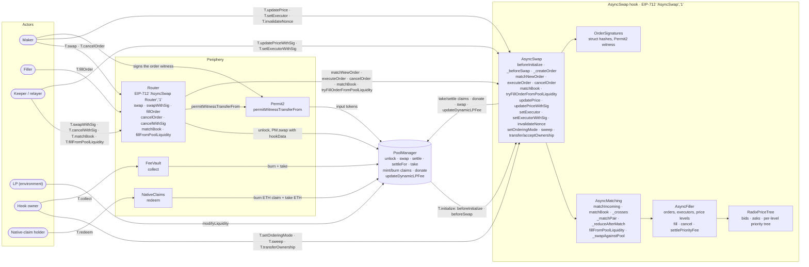

*`T.initialize` only accepts pools that hold N on either side and use the dynamic-fee flag
(`NumeraireRequired`, `DynamicFeeRequired`). This is [T] for the numeraire check, and the dynamic-fee check
is [–]. ETH can only be `currency0` and is never N.*

---

## 2. T.swap: create, bid escrow, matchNewOrder, pool fallback

*One `PM.unlock`, in the exact order of `official/src`: `_beforeSwap` takes the input claim, then
`_createOrder` stores the order and emits `AsyncOrderCreated` with the final salt, then `numeraire.take`
takes the bid claim, then `HookSwap` is emitted. After that the Router settles the input,
`_settlePriorityFee` pays the bid in for the hook, `matchNewOrder` runs `B.matchLoop`, and a remainder tries
`B.poolFill` inside `try/catch`. Sources: `Router.swap` / `unlockCallback` / `_settlePriorityFee`,
`AsyncSwap._beforeSwap` / `_createOrder` / `matchNewOrder`. Lean: `swapBody`, `createBody`, `priorityFeeBody`,
`matchLoop`.*

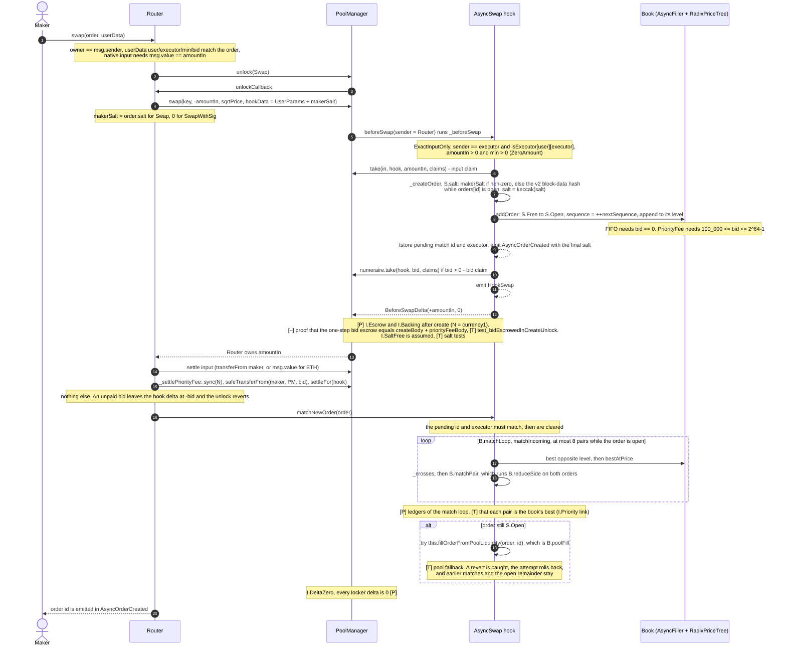

*[T] `I.BalNonNeg` on a buy-side swap with a bid (gap `hgap`). [T] `N = currency0`.*

---

## 3. T.fillOrder, with fee flows

*The filler pays the live gross output from storage: `live = amountOutMin + fee(amountOutMin)`, where
`fee = floor(3·m/997)` is 30 bps of gross. `live` must not exceed `maxPrice`. The filler receives the whole
input through `B.payOut`. The maker gets exactly `m`, the vault gets the fee as a claim, the bid goes to
`B.settleBid`, and the order moves `S.Open` → `S.Closed` (Filled). Sources: `Router.fillOrder` /
`unlockCallback` (FillOrder), `AsyncSwap.executeOrder`, `AsyncFiller.fill`. Lean: `fillBody`, `fillGuard`,
`fill_settlement`. All [P] except where marked.*

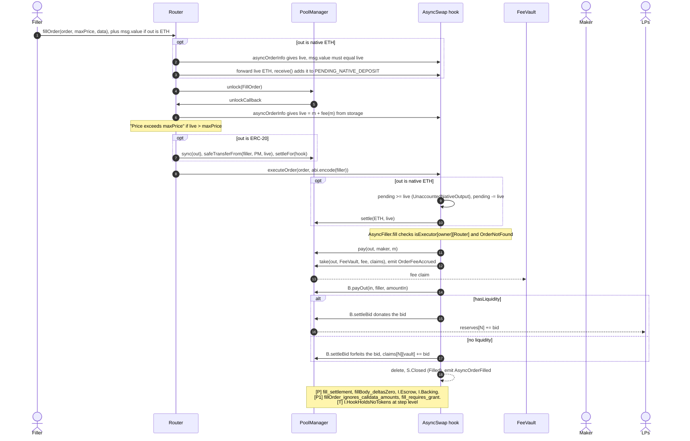

---

## 4. T.fillFromPoolLiquidity: B.poolFill with the 0.30% override

*The hook swaps the whole escrow against LP liquidity. The hook is the swap's sender, so it skips its own
`beforeSwap` and no order is created. The dynamic LP fee is set to `3000` (0.30%) for this swap and the
previous fee is restored afterwards. The swap must consume all of the input and return `y ≥ minOut`.
Sources: `Router.fillFromPoolLiquidity` → `AsyncSwap.tryFillOrderFromPoolLiquidity` →
`fillOrderFromPoolLiquidity` → `AsyncMatching.fillFromPoolLiquidity` / `_swapAgainstPool`. Lean:
`liquidityFillBody`, `liquidityFillGuard`. Decision 10.*

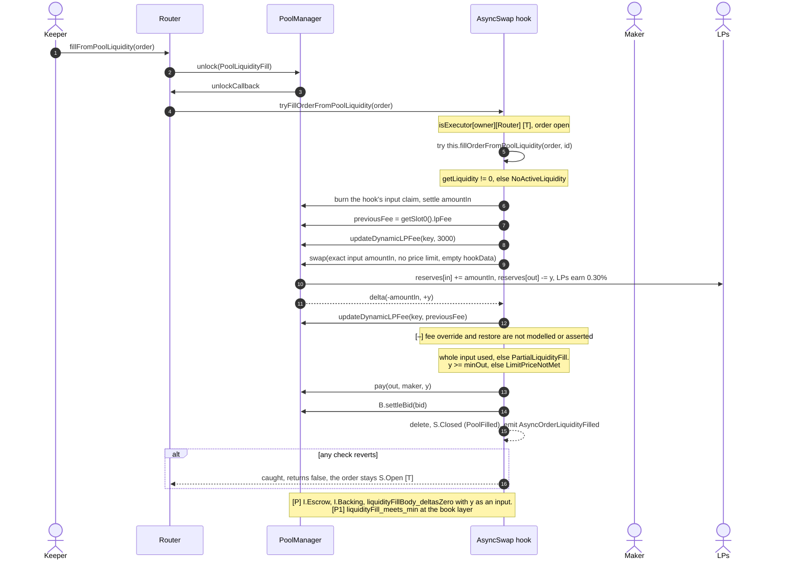

*This path charges no protocol fee. The LPs' 0.30% applies instead.*

---

## 5a. T.matchBook by a keeper

*Anyone can clear a crossed book. The loop takes the best bid against the best ask while `_crosses` holds,
up to `maxMatches` (1 to 8, else `InvalidMatchBound`). In `B.matchPair` the older order rests and its price
sizes the trade, and a zero result stops the loop. `B.reduceSide` pays the counterparty, settles the pro-rata
bid, and either closes the order (S.Closed, Matched) or resequences it. There is no pool fallback. Sources:
`AsyncMatching.matchBook` / `_crosses` / `_matchPair` / `_reduceAfterMatch` / `_settleMatchedPriorityFee`.
Lean: `matchLoop`, `matchPairBody`, `reduceSideBody`.*

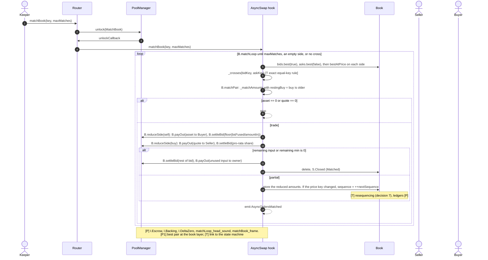

## 5b. T.cancelOrder, with B.settleBid

*The maker cancels. The Router checks the owner, and the hook accepts the owner or a granted executor. The
input comes back through `B.payOut`, and the bid is never refunded: `B.settleBid` donates it if
`hasLiquidity`, or forfeits it to the vault. Sources: `Router.cancelOrder`, `AsyncSwap.cancelOrder`,
`AsyncFiller.cancel` / `settlePriorityFee`. Lean: `cancelBody`, `settleBidBody`, `cancel_settlement`.*

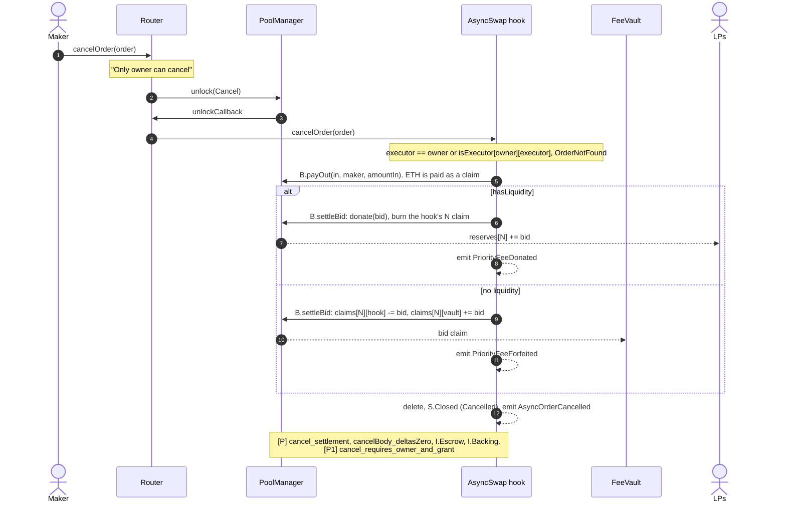

---

## 6. Signed flows: T.swapWithSig and T.cancelWithSig

*`T.swapWithSig`: a relayer submits an order the maker signed. Permit2 pulls the input only if the signature
covers both the transfer and the witness `hashOrder(order)`. The witness does not cover `sqrtPrice` or `salt`
(decision 6), so the Router always passes `makerSalt = 0` and the salt is derived. An optional executor grant
runs `T.setExecutorWithSig` first. Sources: `Router.swapWithSig` / `_settleWithPermit`,
`AsyncSwap.setExecutorWithSig` / `_verify`. Proof status: [P1] (`swapWithSigBody_deltasZero`, `hashOrder_inj`,
`routerPermit_inj`, `tokens_inj`), plus [T] tests.*

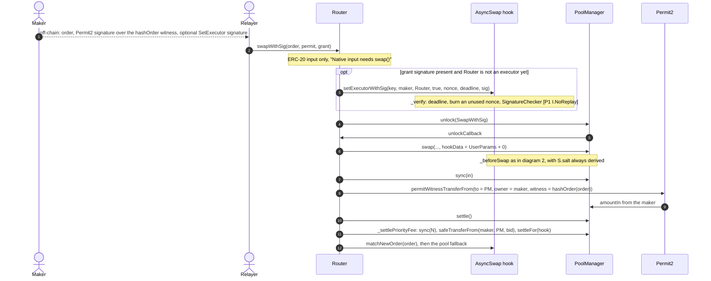

*`T.cancelWithSig` is [P] in V2, with [P1] `cancelWithSig_no_replay` and [P1] `hashCancel_inj`.*

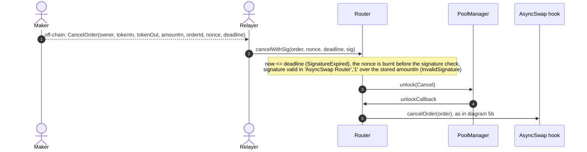

*`T.updatePriceWithSig` uses the same `_verify` in the `'AsyncSwap','1'` domain and needs no unlock [P1].*

---

## 7. Per-order states: S.Free, S.Open, S.Closed

*This is the per-order state machine of `STATE_MACHINE.md` §2.1. `S.Closed` uses the same storage as `S.Free`;
its label only records how the order closed. A closed slot is free again, and the salt walk only steps past
open ids (`I.SaltFree`). Guards come from §2.4.*

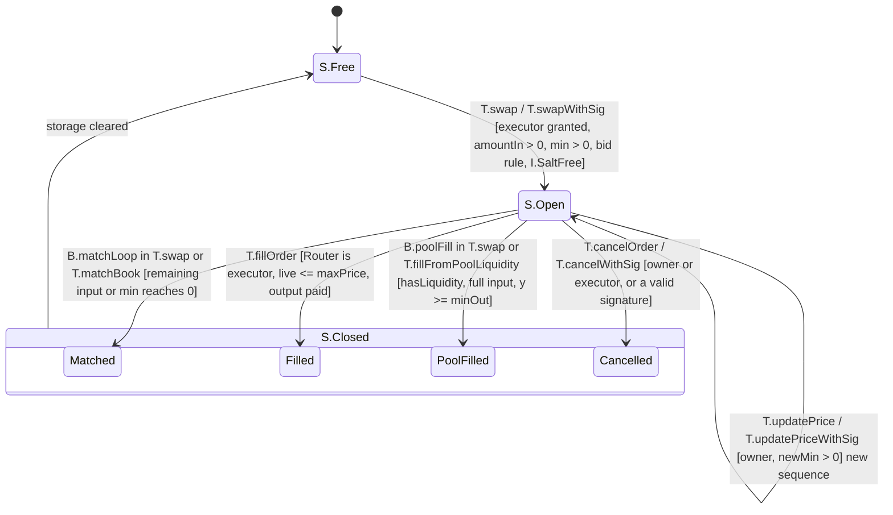

*Every exit from `S.Open` burns exactly the order's remaining escrow: [P] `escrow_closeBody` and
`escrow_reduceSideBody`. A failed `B.poolFill` is caught and the order stays in `S.Open` [T]. A
`B.matchPair` that rounds to zero changes nothing. `T.setOrderingMode` needs an empty book.*

---

## 8. Matching priority: I.Priority and the cross test

*This flowchart shows how `B.matchLoop` picks each pair. Price comes first: the best bid is the highest key
and the best ask the lowest. Within a price level, the ordering mode decides. Crossing uses v2's `_crosses`.
Sources: `AsyncFiller.bestAtPrice` / `_priorityKey`, `AsyncMatching._crosses` / `_reduceAfterMatch`.
`I.Priority` is [P1] at the book layer (`best_spec`, `bestAtPrice_priority`, `priorityKey_lt_iff`,
`fifo_head_earliest`, `reprice_sequence_last`); the link to `matchLoop` is [T].*

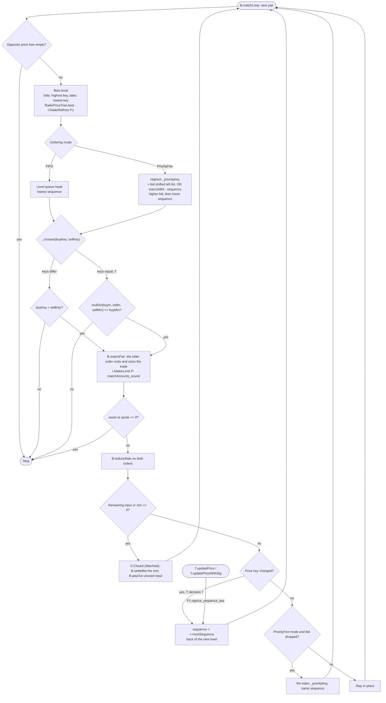

*The loop stops after `maxMatches` pairs: at most 8 in `matchNewOrder`, and the given bound in `T.matchBook`.*

---

## 9. Money flow per currency and the invariants

*This diagram shows where each currency `c` moves, and which invariant boxes each flow stays inside. The
status of each invariant matches `STATE_MACHINE.md` §3 and §4.*

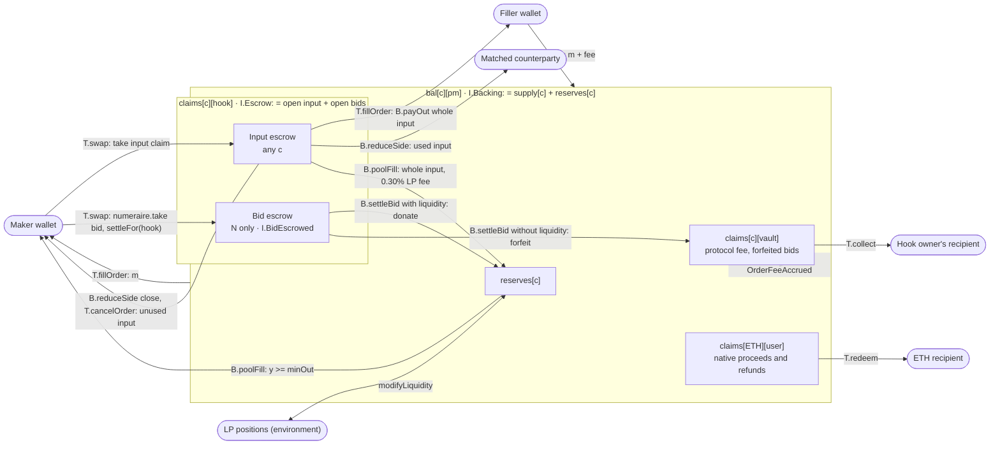

| Invariant | Statement (per currency `c`) | Status |
| --- | --- | --- |
| `I.Escrow` | `claims[c][hook] = Σ open input in c + Σ open bids if c = N` | **[P]** `step_escrow` over all 10 V2 actions; **[T]** for the pool fallback in create and `N = currency0` |
| `I.HookClaimsNonNeg` | `0 ≤ claims[c][hook]` | **[P]** `step_hook_claims_nonneg` (from `I.Escrow`) |
| `I.Backing` | `bal[c][pm] = supply[c] + reserves[c]` | **[P]** `step_backing`, assuming the PM never acts as a party (`Users`); across LP actions it relies on v4's own accounting (assumed) |
| `I.DeltaZero` | every locker delta is `0` when `unlock` returns | **[P]** `*Body_deltasZero`, `matchLoop_neutral` |
| `I.Conservation` | `Σ_{a∈S} bal[c][a]` unchanged | **[P]** `step_conservation`; **[–]** for `T.swapWithSig`, `T.collect`, `T.sweep` |
| `I.ClaimsNonNeg` | `0 ≤ claims[c][a]` for all `a` | **[P]** `step_claims_nonneg`, needs `I.Escrow` before the step |
| `I.BalNonNeg` | `0 ≤ bal[c][a]` for `a ≠ pm` | **[P]** `step_bal_nonneg` **except** gap `hgap`: a buy-side `T.swap` (`in = N`) with a bid. `swapGuard` checks `amountIn` and `priorityFee` against the maker's N balance separately, not their sum. Solidity reverts on the second `safeTransferFrom`, so this case is **[T]** only. |
| `I.SupplyConsistent` | `supply[c] = Σ_a claims[c][a]` | **[–]** not covered (docstring only) |
| `I.SupplyNonNeg`, `I.ReservesNonNeg`, `I.PmBalNonNeg` | `0 ≤ supply[c]`, `0 ≤ reserves[c]`, `0 ≤ bal[c][pm]` | **[–]** not covered. They would follow from `I.SupplyConsistent` + `I.ClaimsNonNeg`, `liquidityFillGuard`'s `y ≤ reserves[out]`, and `I.Backing` (§4 item 10) |
| `I.BidEscrowed` | every open order's bid is held in `claims[N][hook]` | **[P]** at create only (`created_order_escrowed`); the global form `step_all_escrowed` is **[–]**; **[T]** `test_bidEscrowedInCreateUnlock` |
| `I.HookHoldsNoTokens` | `bal[c][hook]` unchanged by fill and cancel | **[P]** as a conjunct of `fill_settlement` / `cancel_settlement`; the step-level form is **[T]**. A native fill passes ETH through the hook transiently via `PENDING_NATIVE_DEPOSIT`. |

*How to read the diagram: every arrow leaving the `I.Escrow` box is a `B.payOut`, `B.settleBid` or
`B.poolFill` burn, the same size as the payment, in the same unlock. That is why each entry point keeps
`I.Escrow` (`escrow_reduceSideBody`, `escrow_matchLoop`, `escrow_closeBody`) and nets the hook's deltas to
zero (`payOutBody_neutral`, `settleBidBody_neutral`). Native ETH paid to a user lands in
`claims[ETH][user]` and leaves only through `T.redeem`. `T.sweep` moves only `bal[c][hook]` and never
touches claims ([P1] `sweep_settlement`).*
